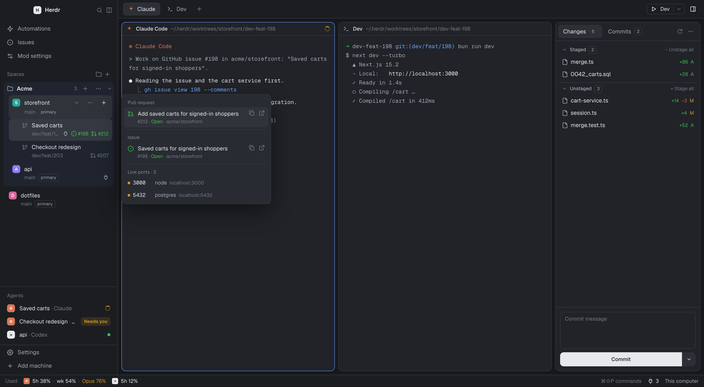

# Orca for Herdr

A Herdr Desktop layout after the Orca app: projects with nested worktrees and their issue/PR
badges, a hover card per worktree, in-app GitHub issues and pull requests, a Create worktree dialog
(from a branch, an issue, a PR or a new name), Files and Git changes panels, run actions, usage
limits and live ports.

See [RECIPE.md](RECIPE.md) for what it does and how it's built, and
[THIRD_PARTY.md](THIRD_PARTY.md) for credits and licenses. The issues, live ports, usage limits and
actions mods are also published on their own in
[VladTemp27/herdr-mods](https://github.com/VladTemp27/herdr-mods).

## Install

Ask your Herdr agent:

> Read ~/.config/herdr-app/AGENTS.md, then add this layout: https://github.com/VladTemp27/herdr-orca

Then two mods by [munza](https://github.com/munza/herdr-mods) that the layout uses but this repo
doesn't include:

> Add this mod: https://github.com/munza/herdr-mods/tree/main/better-changes (in the layout's Changes slot)
>
> Add this mod: https://github.com/munza/herdr-mods/tree/main/better-config

By hand:

1. Copy `layouts/orca.json` into `~/.config/herdr-app/layouts/` and each folder in `mods/` into
   `~/.config/herdr-app/mods/`. Rename anything whose name you already use.
2. Install Better Changes and Better Config from munza/herdr-mods. Set Better Changes'
   `"place"` to `"none"` in its `mod.json`: the layout already has a slot for it.
3. Merge `keys.json` into `~/.config/herdr-app/keys.json` (its `layout:orca` section applies only
   while this layout shows).
4. Run `herdr-app check ~/.config/herdr-app/mods/<name>` for each mod, then
   `herdr-app do layout.switch '{"name":"orca"}'`. `ctrl-shift-l` switches back.

Needs `git` and a logged-in `gh`. Usage limits read the `claude` and `codex` CLIs; Automations uses
the `herdr-automations` CLI; desktop notifications use `terminal-notifier` when installed. Built and
tested on macOS with Herdr 0.1.13.

## Updating this repo

`./sync.sh` copies the layout and these mods from your Herdr home into the repo.
`previews/render.sh` redraws `preview.png` from `previews/preview.html` with headless Chrome:
the preview is an HTML mockup with demo data, so no screenshot of your own work is published.

## License

Apache-2.0, see [LICENSE](LICENSE) and [NOTICE](NOTICE).
