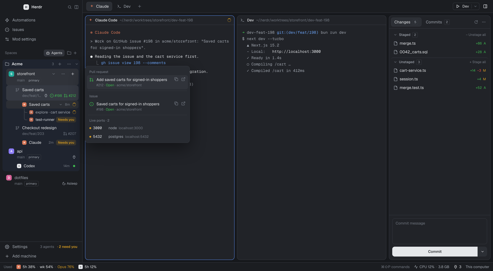

# Orca

A Herdr layout after the Orca desktop app: a left sidebar of projects with their worktrees nested
under them, branch/issue/PR badges and a hover card per worktree; tabs as pills with a run button;
framed panes with headers; a hideable right panel with Files and Git changes; and a status bar with
Claude/Codex usage limits and live ports. GitHub issues and PRs open in-app, and new worktrees come
from a branch, an issue, a PR or a new name.

## What you see

Left to right, top to bottom. No system title bar (`"titlebar": "none"`); macOS traffic lights sit
at 12,16 over the sidebar. The root background is `canvas`; terminals have 14×12 padding.

- **Sidebar** (268px, 44–480, foldable with `cmd-b`):
  - `brand` (46px): Herdr's `workspace-chrome` brand row.
  - `sidebar-nav` (101px): Orca-style links, **Automations**, **Issues** and **Mod settings**, each
    opening its mod as a popup (`automations`, `issues`, munza's `better-config`).
  - **Spaces** (`better-sidebar`): projects by machine and by your own groups (tinted sections you
    name and fill). A repo's main checkout lists its worktrees under it (`├─`/`└─` with a branch icon).
    Each row has a second line: branch, `primary` badge on a main checkout, ↑/↓ when active, then a
    plug icon when it has live ports, the linked issue (green circle `#243`, purple when closed) and
    its PR (state icon `#453`, green open, red closed/failed, purple merged, grey draft).
  - **Agents** (`better-sidebar`, `view: agents`) and a footer (`view: footer`).
- **Tab bar** (42px): `my-tabs` pills for the space's tabs; a **▶ Dev | ▾** run button
  (`t3-actions`, 108px); the right-panel toggle (36px).
- **Main**: the active tab's panes as cards (radius 10, gap 8, 1px `border`, `accent` when focused,
  framed even when alone) with a 30px `my-pane` header: program icon, agent name, folder, status,
  and split/zoom/close on the right.
- **Right panel** (368px, 280–900, hidden until toggled): a stack of **Files** (`files-open-with`)
  and **Changes** (munza's `better-changes`, installed separately).
- **Status bar** (28px): Claude Code / Codex usage windows (`usage-limits`, left), commands and the
  machine (`my-status`), and a **live ports** count button (`live-ports`, 64px).
- A 0px block runs `desktop-notifications` (draws nothing).

Popups and dialogs: the Issues table (92% × 90%, frameless), the issue/PR viewer (86% × 90%), the
worktree hover card (340px window beside the row), **Create worktree** (560 × 780), Add project,
Project settings, Excalidraw (cmd-shift-e), Open in VS Code (cmd-g) and context menus (`my-menu`).

## How it behaves

- **Agent status** is Herdr's: blocked and done show on spaces, tabs, agents and pane headers
  (working spinner, "Needs you", done dot); desktop notifications mirror "needs you" and "finished".
- **Spaces**: click selects, drag reorders within a machine, right-click opens `my-menu`. Hovering a
  repo row shows **⌄/›** (fold its worktrees, remembered; stays visible while folded), **⋯** (the
  menu) and **+** (Create worktree for that repo). Hovering any row ~450ms opens the **hover card**:
  Pull request, Issue and Live ports sections; a row opens the viewer, icons copy the link or open
  GitHub, a port opens in the browser; it closes 250ms after the pointer leaves row and card.
- **Badges**: click opens the issue/PR viewer; ⌘-click opens GitHub.
- **Issues** (from the sidebar nav): Issues/PRs tabs, repo picker, filters, assignee/status menus
  (anchored under the control), Start/Open per row. **Start** opens Create worktree with that issue
  or PR picked, or switches to its space if one is open.
- **Viewer**: issues and PRs. PRs get Conversation / Checks / Files changed (expand a file for its
  diff, first 400 lines), a Pull request card (squash/merge/rebase with a confirm step, close or
  reopen, ready for review), editable assignees, reviewers and labels, linked issues, and Start/Open
  workspace.
- **Create worktree**: Branch · Issue · PR · New tabs; `#123` or a GitHub link jumps to its tab.
  Branch lists checkouts (Open), local and remote-only branches; ↻ fetches origin. Picking fills
  editable **Branch** and **Space name**; a note under Branch says what Create will do (open, check
  out, track origin, or a new branch from a named start). Issues use `dev/feat/{number}` (setting
  `issue_branch` in `mods/new-worktree/mod.json`) or the branch of the open PR that closes them.
  With Claude chosen, an issue/PR task is pasted into Claude's prompt but not sent. One create per
  dialog. When the project has a setup script, a **Setup script** row offers **Run** / **Skip**.
- **Worktree setup hooks**: a new worktree runs the repo's team script (`scripts.setup` in
  `herdr.yaml`, else Orca's `orca.yaml`, first) and then the project's local setup script, with
  `HERDR_ROOT_PATH`, `HERDR_WORKTREE_PATH`, `HERDR_WORKSPACE_NAME` (Orca's `ORCA_*` names and
  `CONDUCTOR_ROOT_PATH` are set too, so Orca scripts run unchanged). It runs in your login shell
  (`$SHELL -lic`), so tools your profile puts on PATH (pnpm, nvm, mise) are found. Run by default,
  skip by default, or ask every time. "Wait for setup" runs it first and then the agent in one
  terminal; otherwise the agent starts at once and setup runs in its own **Setup** tab, with the
  agent's tab kept in front. It reports "Setup finished." or "Setup failed (exit N)."
- **Project settings** (space menu → Project settings…): display name and icon (Automatic, Emoji or
  Letter, with a colour);
  **Worktrees**: default base branch, worktree location (instead of `~/.herdr/worktrees/<repo>`),
  issue branch name (`{number}`, `{slug}`), default agent; **Worktree hooks**: the variables (hover
  for what each holds), the team script (`herdr.yaml` or `orca.yaml`) read-only, the local setup script (saved on this
  machine), **When to run** (Ask every time / Run by default / Skip by default) and **Wait for setup
  to complete before starting agent**; and Remove project.
- **Files**: clicking a file opens it in its own tab (Markdown rendered with a Source toggle), reusing
  the tab already showing it; right-click opens it in your apps.
- **Changes**: staging, commit/amend, history, diffs in one centre tab (Better Changes' own docs).
- **Automations**: scheduled agent prompts, through the `herdr-automations` CLI.
- Keys (merge `keys.json`): `cmd-n` new worktree, `cmd-shift-n` add project, `cmd-g` VS Code,
  `cmd-shift-e` Excalidraw; in this layout `cmd-shift-a` toggles Agents, `cmd-shift-b` the right
  panel, `cmd-w` / `cmd-shift-w` close a tab / pane.

## Built from

`layouts/orca.json` and 21 mods in `mods/`. Shipped mods it uses as-is: `workspace-chrome`, `files`,
`changes`, `pane`, `confirm`, `picker`, `machine-add`. Installed separately from munza/herdr-mods:
`better-changes` (the `changes` slot, `"place": "none"`) and `better-config`.

- `better-sidebar` (munza's Better Sidebar, modified; views by `props.view`: spaces, `agents`,
  `footer`, `panel-toggle`, `card`, `groups`), `my-tabs`, `my-pane`, `my-status`, `my-menu`
  (terminal and space menus; `terminal_menu: "my-menu"`), `my-new-menu`, `my-worktree` (remove
  confirm): modified clones of Herdr's mods.
- `issues` (table, viewer, `pr.js`, `start.js`, `prefill.sh`), `new-worktree` (dialog, `git.js`,
  `hooks.js`), `project-settings` (with the same `hooks.js`: keep the two copies identical),
  `files-open-with` (+ `file-icons` for Material icons), `t3-actions`, `sidebar-nav`,
  `automations`, `usage-limits` (`helpers/*.sh`), `live-ports`, `desktop-notifications`,
  `new-project`, `open-vscode`, `excalidraw`.
- Shared state keys: `live-ports`, `better-sidebar.hover`, `pane-heads`, `issues.pick`,
  `issues.changed`, `projects.settings` (per `JSON.stringify([machine, main checkout])`: name, icon,
  `base`, `location`, `issue_branch`, `agent`, `setup`, `setupWhen`, `setupWait`),
  `projects.location`, `files-open-with.tabs`,
  `better-changes.*`. Git config: `branch.<b>.herdr-issue` / `herdr-pr` = `owner/repo#N`.
- Programs: `git`, `gh` (logged in), `curl` (avatars), `osascript`/`pbcopy`/`open` on macOS,
  `claude` / `codex` CLIs for usage limits, `lsof` for ports, `terminal-notifier` if installed,
  `code` for VS Code, `herdr-automations`, `hc` and `herdr-app`.

## Watch out

- Popups default to "the pointer", which Herdr doesn't track over dialogs: anchor them from the
  pressed control's `bounds` (as `issues` does).
- `hc wait <your own terminal>` doesn't honour `--timeout`; don't use it to sleep.
- Claude prints a non-breaking space after `❯`; the prefill helper matches `^❯` and waits past the
  folder-trust prompt.
- `cx.spawn` runs synchronously until its first `await`; don't call into state the constructor
  hasn't built yet.
- GitHub only links "Closes #N" when the PR targets the default branch; badges also read the body
  and the branch name.
- The hover card is a `window` overlay (doesn't take the keyboard); worktree badges need `gh`.
- Remote machines: prefill falls back to the clipboard; media and watchers are local-only.
- `herdr.yaml` / `orca.yaml` are parsed only for `scripts.setup` (one line, or a `|` / `>` block),
  not as full YAML. `herdr.yaml` wins when both exist.
  The setup script also runs when Create opens an existing checkout that has no space open yet.

## Done when

- `herdr-app check` passes for every mod, `layout.switch {"name":"orca"}` shows it, and
  `herdr-app status` lists no errors.
- A repo row shows ⌄ ⋯ + on hover; + opens Create worktree on that repo.
- Picking a remote-only branch creates a tracking worktree and a space; a picked issue fills
  `dev/feat/N` and its title; pressing ⌘↵ twice makes one space.
- A repo with `scripts: setup: echo $HERDR_WORKTREE_PATH` in its `herdr.yaml` (or a local script in
  Project settings) prints the new worktree's path and "Setup finished." when a worktree is created;
  with "Wait for setup" off, it runs in a Setup tab beside the agent's.
- A worktree with a linked issue and PR shows both badges; hovering shows the card; clicking a badge
  opens the viewer with PR tabs and the merge card.
- Clicking a Markdown file in Files opens it rendered in a new tab; clicking it again reuses the tab.
